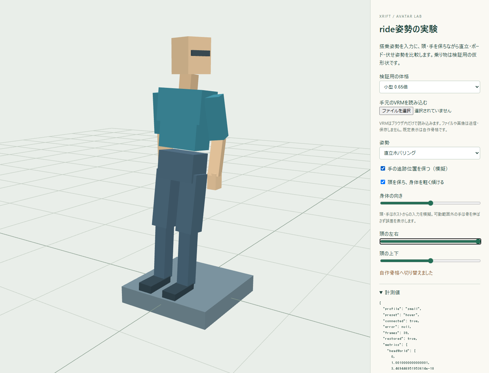

# XRift Avatar Pose Control

rideで特殊な乗り物へ搭乗するときのアバター姿勢を調整する、Three.jsベースの実験用コアです。頭上プロペラv9と鳥人間の調査・不具合再現を起点に分離しました。

## 起動

```sh
npm ci
npm run dev
```

Node.js 22以上。http://127.0.0.1:5228/ を開きます。元の座り姿勢／直立／ホバリング／ボード／伏せ姿勢を比較できます。乗り物は仮形状で、搭乗・頭・手の入力はデモが模擬しています。実XRiftのSeatそのものを起動するデモではありません。



## 入っているもの

- 明示的なhumanoidの役割→Bone対応表、または既存の名前推定による骨格準備。
- 頭・追跡手を保つ直立と伏せ姿勢、軽い身体追従、頭基準の水平方向。
- 描画中だけ適用し、最も外側の描画が終わってから元へ戻すトランザクション。ミラーの入れ子・一人称／三人称の関連スキン・二重適用を考慮。
- 脚折れ、衣服の反転、欠けた親ボーン、四本脚、頭・手・指・顔の保持、復元の回帰テスト。
- XRiftの所有者を解決する補助アダプター。

## 使用例

```js
import { prepareHumanoidRig, attachPoseDriver } from './src/index.mjs'
const rig = prepareHumanoidRig({ mesh, bones: humanoidBoneMap })
const driver = attachPoseDriver({
  scene, rig, relatedSkeletons,
  getOptions: () => ({
    enabled: isRiding, preset: 'hover',
    heading: bodyHeading, preserveHands: isInVR
  })
})
// driver.lastは直近の計測、driver.errorは適用エラー。
// ride解除／アンマウントで元の姿勢と描画フックへ戻す。
driver.dispose()
```

明示マップは選んだSkinnedMeshのpaletteに必要な人型骨があることを検査します。メッシュ外のnormalized骨を無条件に渡さず、VRMローダーからraw骨を取得してください。独自骨名でもマップが正しければ名前推定を避けられます。選んだpaletteに必須骨がない場合は追加対応が必要です。

`./xrift`のselectRiderRigは元実験のホスト慣習を使います。アバター実体の公開取得APIがあると仮定しません。VRMローダー等から対象を明示できる場合は、その経路を優先します。

## 境界

ここで扱うのは描画姿勢です。Vehicle移動・入力・衝突・着地・カメラ・アイテムの所有権や同期は利用側が担当します。ボードの足固定、コックピットへの腰合わせ、手足と腰の同時拘束、自然な乗降アニメーションは今後の実験対象です。

元の低レベルモジュールも残っていますが、既存standing／proneの別々の描画フックを同じ身体へ混ぜず、新しいattachPoseDriverを入口にしてください。src/reproの旧版は意図的に不具合を残した比較用で、公開APIからはexportしません。

`npm run verify`で単体30件・型の利用例・デモビルドを確認します。

- [乗り物・姿勢・VRMの実験指針](docs/EXPERIMENTS.md)
- [次のスレッドへ渡す文](docs/NEXT_THREAD.md)
- [現状と確認範囲](docs/STATUS.md)
- [来歴・ライセンス](docs/PROVENANCE.md)
