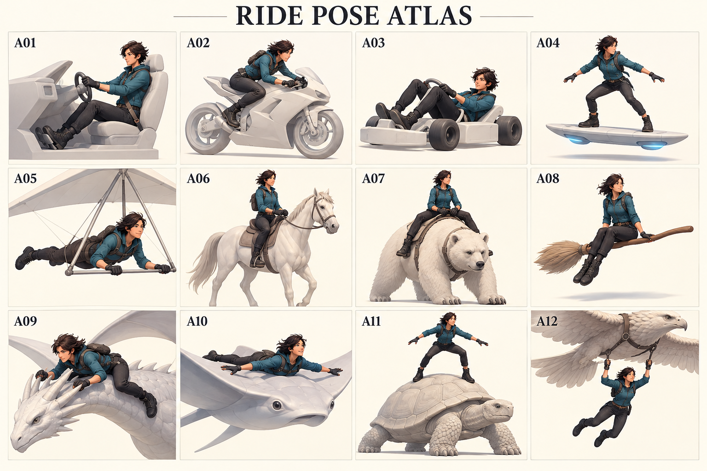
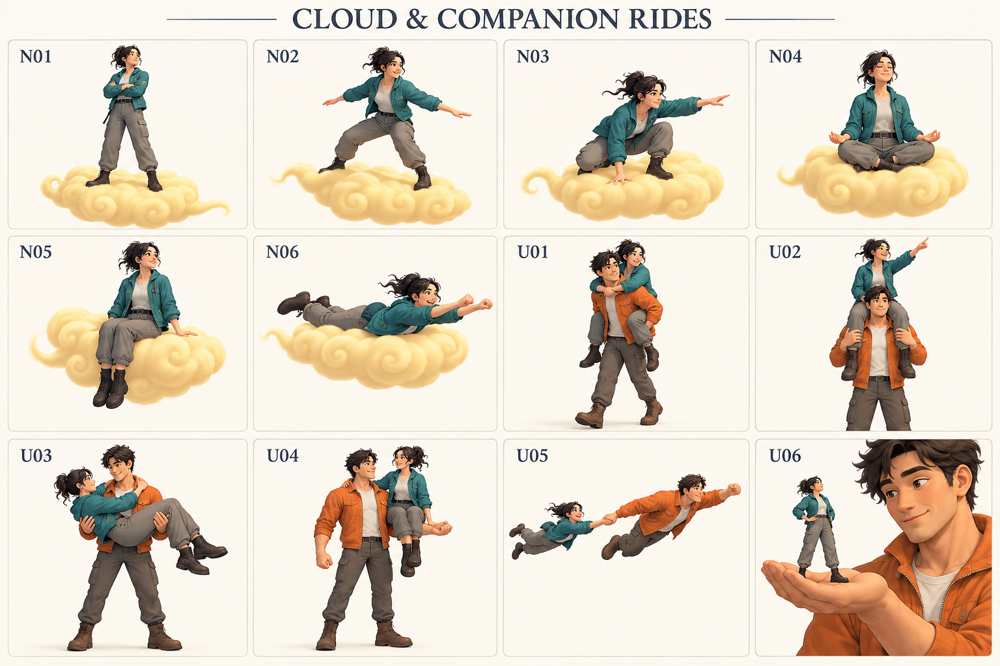

# 乗る姿勢の空想帳 v1

2026-10-25。仕様化より先に「こんな姿勢で乗れたら面白い」を集める探索資料。すべて提案で、採用・実装・XRift対応を意味しない。乗り物や動物の3Dモデル構築はこの相談の対象外。

同日追記：ユーザーがN02（筋斗雲サーフ姿勢）・U02（肩車）を実験対象に選定し、[ローカル実験へ進みました](experiments/selected-poses-2026-10-25.md)。以下の画像・候補一覧は空想段階の参照として残します。

先に見たい姿を作り、好きなものを選び、その姿へ近づける調整を試す。現在のプリセットで表せる範囲だけに発想を制限しない。ここでの分類とIDは会話・画像参照用であり、APIやプリセット名の決定ではない。

## 画像から眺める

### 乗り物・動物・幻獣：12の入口

| 画像ID | 対象と姿勢 | 見比べたいところ |
|---|---|---|
| A01 | 自動車：椅子座り | 腰・背中を預け、足を前へ出す |
| A02 | スポーツバイク：前傾またがり | 腰より前へ胸が出て、手と足でも支える |
| A03 | カート：深く寝かせた座り | 背中を倒し、膝を高くする |
| A04 | ホバーボード：横向き立ち | 前後に開く足、膝、肩と腰のねじれ |
| A05 | グライダー：腹ばい | 胴を支え、頭を起こして前を見る |
| A06 | 馬：上体を起こしたまたがり | 脚を左右へ下ろし、足置きを使う |
| A07 | 巨大な熊：幅広またがり | 胴の太さによる股関節・膝の開き |
| A08 | 魔法のほうき：横座り | 両脚が同じ側へ出る非対称性 |
| A09 | ドラゴン：首へ伏せる | 胸を近づけ、角をつかみ、脚で挟む |
| A10 | 巨大マンタ：背に腹ばい | 広い支持面、腕を広げる浮遊感 |
| A11 | 巨大亀：甲羅に立つ | 丸い面で足を広げ、膝で釣り合う |
| A12 | 巨鳥：下へぶら下がる | 手が上、腰・脚が下に垂れる |

### 筋斗雲6姿勢＋ユーザーへのライド6姿勢

| 画像ID | 案 | その姿勢の面白さ |
|---|---|---|
| N01 | 筋斗雲で仁王立ち | 腕組みで余裕、足はしっかり踏む |
| N02 | 筋斗雲でサーフィン | 曲がる方向へ体重を預ける |
| N03 | 筋斗雲で低くしゃがむ | 加速や急旋回に構える、片手を雲へ |
| N04 | 筋斗雲であぐら | 瞑想・仙人のゆったりした旅 |
| N05 | 筋斗雲の縁に腰掛ける | 足をぶらぶら、会話しながら移動 |
| N06 | 筋斗雲で腹ばい飛行 | 胸を預け、頭を起こして飛ぶ |
| U01 | おんぶ | 背中を支えに脚と腕を回す |
| U02 | 肩車 | 高い目線、両脚は相手の胸側へ |
| U03 | 横抱き・お姫様抱っこ | 背と膝裏を支え、全身を横に預ける |
| U04 | 腕に腰掛ける | 片側だけに座る、左右非対称な遊び |
| U05 | 手をつないで牽引飛行 | 座らずに引いてもらう、身体は後ろへ流れる |
| U06 | 巨大ユーザーの手のひら | 乗る側は普通に立ち、運ぶ側が支える |

画像はbuilt-in image_genによる想像図。実VRMの姿勢、支持の成立、実機の見え方は未検証。細かな接触位置や角度は確定しない。特にN06の脚は曲がっており、U04は腕と胴へ寄りかかっている。プロンプト全文と画像の差分は[PROMPTS.md](concepts/2026-10-25/PROMPTS.md)に記録。

## さらに広げる48候補

画像の24例に加えて、次の方向へ広げられる。同じ乗り物を複数の姿勢に登場させてよい。「現実には乗れない」も歓迎する。

### 1. 座って運ばれる

| 候補 | 身体のイメージ |
|---|---|
| スクーター | 背を起こし、膝をそろえて足を床へ |
| リカンベント自転車 | 背を倒して、脚を遠く前へ伸ばす |
| ジェットコースター | 深く座り、両手を上げる／手すりへしがみつく |
| 空飛ぶソファ | 背もたれへ横に崩れ、片腕をひじ掛けへ |
| 巨大な葉っぱの舟 | 膝を抱えて狭いくぼみに収まる |
| 魔法の絨毯 | 長座で脚を伸ばす／端に腰掛ける |

### 2. またがる・挟む

| 候補 | 身体のイメージ |
|---|---|
| ラクダ | 高い腰位置、前後に揺られながら上体を起こす |
| 巨大オオカミ | 毛へ手を埋め、低い前傾で背に沿う |
| ダチョウ | 細い胴に脚を寄せ、上下の揺れを膝で受ける |
| ユニコーン | 背筋を伸ばした優雅な騎乗／横座り |
| グリフォン | 翼の付け根を避け、胴にしがみつく |
| 巨大な蛇 | 長い胴を脚で挟み、波打つ背へ上体を合わせる |

### 3. 立つ・踏ん張る

| 候補 | 身体のイメージ |
|---|---|
| スノーボード | 横向き、両膝を曲げて腰を落とす |
| 水上スキー | 足を前へ、腰を後ろへ引きロープへつかまる |
| 一輪ホイール | 狭い足幅、小さな前後傾斜でバランス |
| 空飛ぶ剣 | 一直線の狭い足場、両腕で釣り合う |
| 巨大な鯉 | 濡れた背でしゃがみ気味に立つ |
| 動く石柱 | まっすぐ立つ／急停止で片脚を前に出す |

### 4. 膝・尻・横向きで乗る

| 候補 | 身体のイメージ |
|---|---|
| 小舟 | 片膝立ちで漕ぐ、左右へ身体をひねる |
| 空飛ぶ座布団 | 正座、つま先を後ろへ収める |
| 巨大な蓮の葉 | あぐら、両手は膝の上 |
| そり | 膝を抱える体育座り／脚を前へ伸ばす |
| 巨大な本 | 本の端へ横座り、片手で後ろを支える |
| 透明な泡 | 狭い球内で丸まり、膝を胸へ寄せる |

### 5. 寝る・身を預ける

| 候補 | 身体のイメージ |
|---|---|
| 空飛ぶベッド | 仰向け、腕を頭の後ろへ |
| 巨大クジラ | 背へ腹ばい、身体を曲面へ沿わせる |
| 巨大カワウソ | 腹の上で仰向けに運ばれる |
| 飛行棺 | 仰向け、腕を胸で交差する |
| 浮遊ハンモック | 腰が沈み、膝と頭が少し高い |
| 巨大な羽根 | 横向きに寝そべり、片肘で頭を支える |

### 6. しがみつく・ぶら下がる

| 候補 | 身体のイメージ |
|---|---|
| 巨大トンボ | 胸と脚で細い胴へ抱きつく |
| 飛行風船 | 片手でロープを握り、全身が下へ垂れる |
| ロック鳥の足 | 両腕で足を抱え、膝を曲げる |
| 巨大な尻尾 | 腕と脚で巻きつき、横揺れについていく |
| 空飛ぶ傘 | 頭上の柄を握る、肩が上がり脚は浮く |
| 動く天井 | 両足で逆さにぶら下がり、手を下へ垂らす |

### 7. 誰か・何かに運んでもらう

| 候補 | 身体のイメージ |
|---|---|
| 他ユーザーの片肩 | 腰を片側に乗せ、脚を相手の前後へ垂らす |
| 他ユーザーの足の甲 | 向かい合い、手をつないで一緒に歩く |
| 2人による組み手の椅子 | 腰を2人の手へ、背を起こして両脚を垂らす |
| 巨大ユーザーの帽子 | 帽子の縁に腰掛ける／頂上で踏ん張る |
| 大きなゴーレムの肩 | 外側へ脚を垂らし、頭の横へ手を置く |
| 巨大ロボットの胸ポケット | 胸から上だけ外へ、両手を縁に置く |

### 8. 「乗る」を拡張する変なもの

| 候補 | 身体のイメージ |
|---|---|
| 自分の影 | 立ったまま影だけが先へ滑り、身体が引かれる |
| 走るドア | ドアノブを握り、片足を下辺へ置く |
| 巨大な時計の針 | 長い棒へ横座り／両脚で挟む |
| 空飛ぶたい焼き | 背へしがみつく／口から半身を出す |
| 回転する惑星 | 球面上に立ち、頭の上方向が周回で変わる |
| 空中のジッパー | 引き手を両手でつかみ、開きながら運ばれる |

## 同じ対象でも、乗り方を変える

筋斗雲は6枚で終わらず、「仁王立ち→加速でしゃがむ→巡航であぐら→友人が来たら縁に腰掛けて話す」という一続きの体験にもできる。静止姿勢の格好よさと、姿勢が切り替わる面白さは分けて眺める。

ドラゴンなら、首にまたがる、背中に立つ、背に腹ばい、脚につかまる、尾に巻きつく、手のひらに座る。同じ生き物でも身体の預け先を変えるだけで別の乗り方になる。

ユーザーライドは「乗る側」だけでなく「運ぶ側」も絵になる。おんぶでは運ぶ側が前傾し、横抱きでは両腕と胸が支え、肩車では脚を保持する。そのため2人の姿勢を一組として選びたい。U05の牽引は座面がない乗り方の候補で、通常の着座と同じ仕組みでできるとは仮定しない。

将来のギミック相談では、双方の開始への同意、どちらからでも解除できること、体格差、相手の動きへの追従、他者からの見え方が論点になる。ただし今回はその仕様も実装も確定しない。おんぶの上に肩車するような多段ライドも空想候補には残すが、最初の検証には選ばない。

## 選んだ絵を調整目標にするときのメモ

今は数値やJSONを埋めず、各候補に次の短いメモがあればよい。

- どんな気分にしたいか：威厳、くつろぎ、スピード、必死、可笑しさ。
- 身体をどこへ預けるか：足裏、尻、胸、背、膝、手、相手の身体。複数あってよい。
- 何を自由にしたいか：見回す、手を振る、相手を見る、腕を組む。
- どこから見て格好いいか：正面、側面、背面、一人称。画像1枚では死角が残る。
- 何が崩れたら残念か：足が浮く、脚が貫通する、腰が滑る、首が窮屈、服が破綻する。

最初の比較セット案はN01/N02/N04（同じ雲で支持・膝・座りが変わる）、A06/A07（同じまたがりで幅が変わる）、A05（胸で支える）、U01/U03（2人の支持が変わる）。これは候補選定の提案であり、実装の着手順序ではない。

次の対話では「この絵が好き」「もっと偉そうに」「両手を自由にしたい」のような反応から絞る。その後、選んだ姿勢を正面・側面・背面で描き、目標像をそろえてから調整実験へ進む。正式な規格・実現性判定はその後。

## 今回の境界と記録

- 入力：ユーザーの探索依頼、README、EXPERIMENTS、NEXT_THREAD、STATUS。生成には実VRMや第三者素材を使っていない。
- 変更前：実験指針の主要題材はR01〜R04、画像付きの広い空想カタログはなかった。
- 変更後：24の画像例、追加48候補、選定時の観察メモを追加。A/N/Uの画像IDと既存R01〜R04は別の参照番号。
- 判断：実装できる姿勢だけで候補を削らず、画像の好みから調整対象を選ぶ。既存の実験優先順位を自動で置き換えない。
- 実装：姿勢ドライバ、デモ、ride-spec-template.jsonは変更していない。
- 未確認：追加候補の実現性、実VRMへの適用、XRift接続、Quest、他者視点、複数人ライド。画像生成の成功を姿勢実装の成功と扱わない。
- 検証：資料追加後のnpm run verify成功（既存30テスト・型チェック・デモビルド）。既存の500 kB超バンドル警告あり。デモ表示・コードは未変更のため、新しいデモ撮影は実施していない。

選定後の技術実験には[EXPERIMENTS.md](EXPERIMENTS.md)と実験記録テンプレートを使う。
