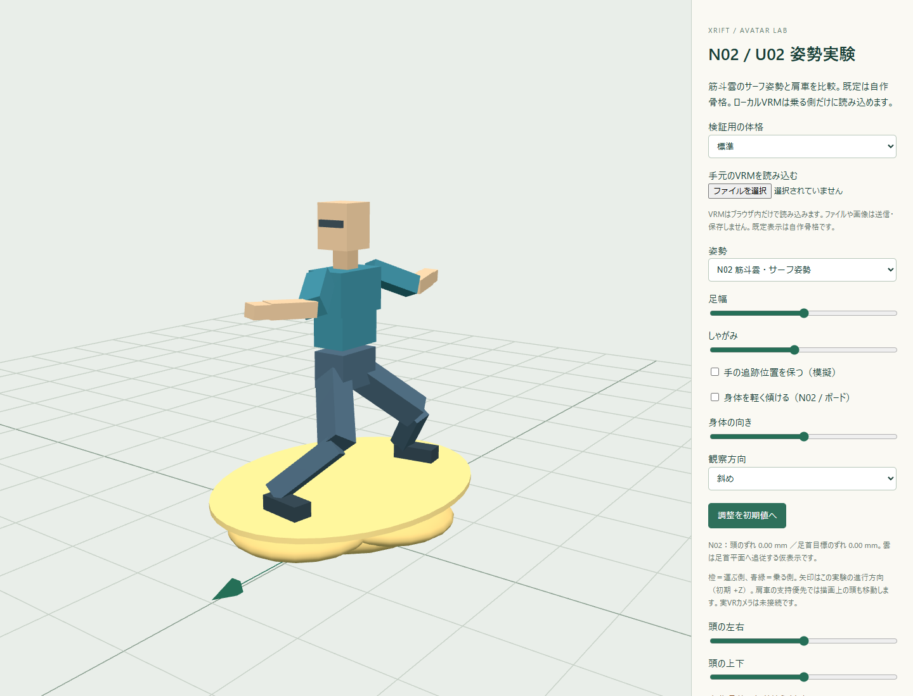
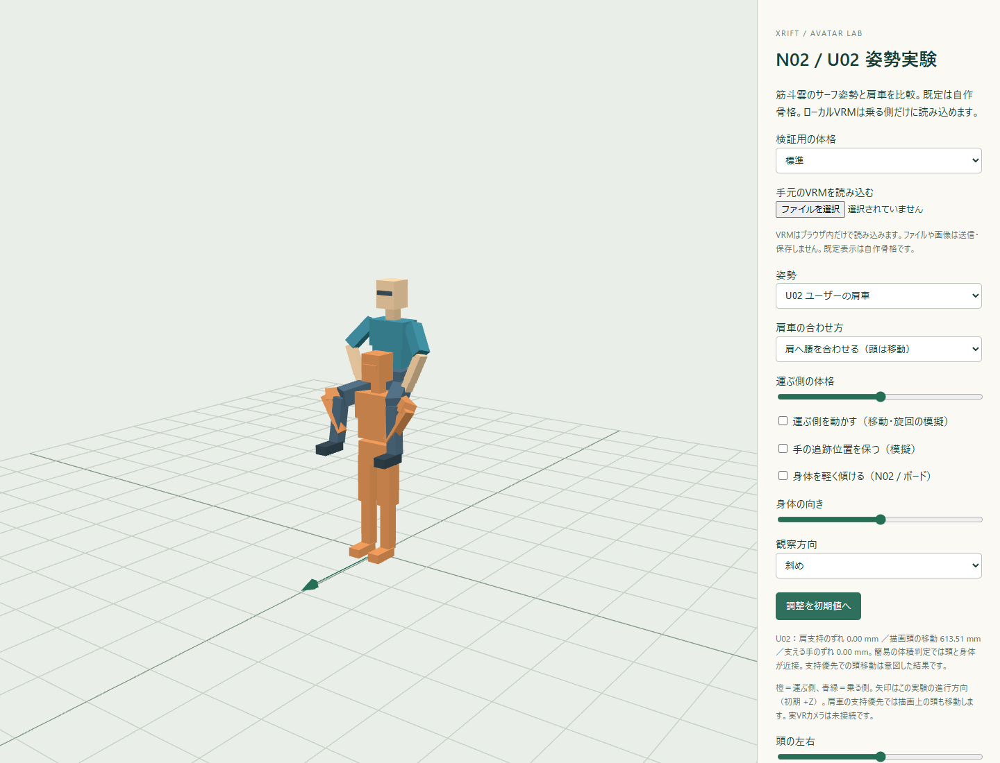

# N02筋斗雲・U02肩車：ローカル姿勢実験

2026-10-25。ユーザーが空想帳からN02とU02を選び、並列の実装・観察を依頼したことを起点にする。実験の対象は自作骨格の描画姿勢。乗り物モデルの制作、実XRiftへの接続、公開は含めない。

## 触れる入口

`npm run dev` → http://127.0.0.1:5228/ 。N02が初期表示。姿勢からU02へ切り替える。

- N02：足幅、しゃがみ、身体の向き、頭の向き、模擬手保持、軽い身体傾斜。
- U02：肩支持優先／頭位置保持、運ぶ側の体格、移動・旋回の模擬。
- 共通：標準／小型0.65／大型1.35／頭ピボット前ずれ、斜め／正面／側面／背面、初期化、元の座り姿勢への切り替え。
- 手元のVRMは乗る側だけに読込可能。運ぶ側は自作骨格。今回、実VRMでの確認はしていない。

この実験の進行方向は初期+Z、N02は胴を横向きにする。既存XRiftのheading解決APIの軸契約を変更したものではない。

## 分担と観察からの修正

| 担当 | 作業 | 独立した確認 |
|---|---|---|
| N02実装 | 横向き、脚IK、バランス腕、到達誤差 | 体格・欠けた親・衣服・復元の単体実験 |
| U02実装 | 腰の支持、肩車の脚、運ぶ側の脛保持 | 支持と頭の競合、体格差、腕IKの単体実験 |
| 観察 | baseline、目標と実測の批評、ブラウザ観測関数 | N02の膝角未達とU02の体格差干渉を指摘 |
| 統合 | UI、2体の適用順、撮影、全体検証 | 数値結果と正面・横・背面の画像を照合 |

## 入力と変更前後

N02の入力は元の座り姿勢、自作標準骨格、足幅倍率1、しゃがみ.45。旧boardは膝曲げ約9.67度・足首間隔0.20mだった。N02では約67度・約1.03mとなり、頭位置と骨長を保ちながら横向きに両足を広げ、両腕でバランスを取る。

足首は同じ水平面へ合わせる。既定では頭位置保持から支持高さが決まるため、雲の表示が足へ追従する。固定した支持物に対して身体を合わせた実証とは区別する。コアの明示`supportHeight`は固定した足首平面を試せるが、届かなければ足誤差を残す。

N02の幅1.4・しゃがみ1では、足首誤差がほぼゼロでも膝は希望100度に対し約76.65度。観察を受けて`poseLimited`・希望角との差を追加した。UIにも未達を表示する。

雲は支持を眺める仮形状。初版の曲面だけの表示から、修正版は平らな楕円面とその下の丸い仮形状へ変更。標準自作骨格の靴底は足首から0.0625m下なので、体格倍率をかけて支持面を下げる。これは自作骨格の寸法であり、実VRMの靴底を自動取得したものではない。

U02の入力は乗る側・運ぶ側の自作骨格、運ぶ側の左右肩と頭のworld座標。元の着座から、腰を肩中心の少し上・後方へ合わせ、腿を首の左右から前へ出し、下腿を胸側へ下ろす。支持優先では腰目標の誤差はほぼゼロだが、標準同士で描画頭が約613.5mm移動する。頭保持優先では頭差がほぼゼロになり、同程度の支持誤差が残る。

初版の小型の乗る側×大型の運ぶ側では頭と胴が干渉した。後方距離が乗る側だけで縮むことが原因。修正版は運ぶ側の肩幅・頭高も参照し、同条件で0.13→0.27mへ変更した。頭・胴の簡易proxy分離量は−100.25→＋39.75mm。標準同士の既定位置は保ち、保守的proxyが負になる場合は近接警告を残す。proxyの正値は実メッシュ無干渉の保証ではない。

運ぶ側の両手も、乗る側の左右のすねへ合わせる。先に乗る側を解き、その描画フレームの膝・足首間55%の点を手の目標にしてから運ぶ側を解く。前フレームの脛位置へ遅れて追従する作りにしない。2体の姿勢は最も外側の描画後にともに復元し、ミラー等の入れ子描画中は保持する。

v2の再観察では、小型×大型の頭と胴は離れたものの、乗る側の下腿・靴が運ぶ側の胴へ隠れた。v2のこの体格組合せは目視未合格。腰と手の目標誤差がゼロでも、実際の身体同士の交差は別に確認する。

v3では体格比から脚の開きも自動調整し、小型×大型のspreadを1→1.8、膝間隔を0.349→0.464mへ改善した。下腿／胴proxyは−90.54→−33.29mm、靴／胴proxyは−73.70→−0.61mmで、脚の近接が残る。この組合せはv3でも未合格として残し、デモでも近接の可能性を表示する。標準同士はspread1を維持した。

## 実際に観察する点

体格差の側面は[初版](../screenshots/u02-small-passenger-tall-carrier-2026-10-25.png)・[v2](../screenshots/u02-small-passenger-tall-carrier-v2-2026-10-25.png)・[v3](../screenshots/u02-small-passenger-tall-carrier-v3-2026-10-25.png)を比較する。各版の画像と数値結果を残し、修正版で上書きしない。

個別の正面・側面・背面は`docs/screenshots/n02-*` / `u02-*`。詳細な独立レビューは[観察記録](observer-2026-10-25.md)、コアの数値は[N02](n02-core-2026-10-25.md)・[U02](u02-core-2026-10-25.md)。

## 確認範囲と残る課題

`npm run verify`成功：単体48件、型の利用例、デモビルド。最終ログは[selected-verify-v3-2026-10-25.txt](selected-verify-v3-2026-10-25.txt)。500kB超のバンドル警告は初期版から継続しています。

最終ブラウザ観測は22条件、ページ例外0、非GETリクエスト0。[観測JSON](selected-browser-v3-2026-10-25.json)・[撮影条件JSON](selected-captures-v3-2026-10-25.json)を保存。初版・v2のJSONとCLI全文ログも別ファイルで残しています。v3は小型×大型の交差条件も数値記録へ追加しましたが、その目視は未合格。到達不能な模擬手位置はN02で約70.8mm、U02で約597.9mmの誤差があり、全拘束の成立を意味する22条件ではありません。

- 自作骨格の標準／拡縮・異比率・省略親・衣服補助骨と、ローカルデモを対象にする。別作者の実VRM複数体の検証ではない。
- 支持誤差は腰や足首の参照点の距離。皮膚接触、荷重、衣服・髪の衝突は未実装。
- 「模擬手保持」は元の座り姿勢の手位置を目標にする。身体の位置が変わると届かず、N02/U02とも誤差が出る。到達不能を骨の伸長で埋めない。運ぶ側の脛保持も手の点の一致までで、指の握りやVR手入力との両立は未確認。
- カメラ・操縦入力をこのコアから変更しない。支持優先での描画頭移動は、VR一人称の頭追跡との両立を証明しない。
- 複数クライアント、相互同意、乗降・解除の同期、通信遅延、実XRift、Quest、他者からの見え方は未確認。

次は手元の実VRMを乗る側へ読み込み、N02の足裏・服と、U02の首・腿・頭の干渉を同じ視点から比較する。画像の目標に近づける調整を続け、採用条件が見えてから規格へ整理する。
